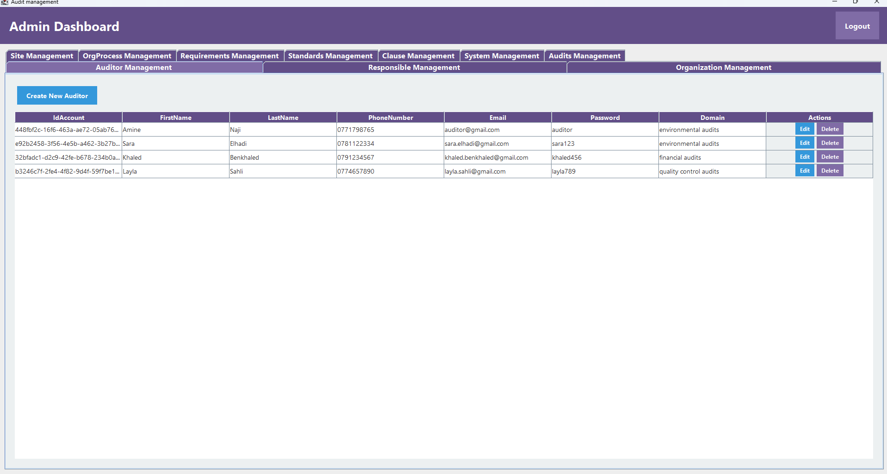

# AuditDesk: Enterprise Java Desktop Audit Management System

[](https://openjdk.org/)
[](https://docs.oracle.com/javase/tutorial/uiswing/)
[](https://jwt.io/)
[](https://github.com/FasterXML/jackson)
[](https://maven.apache.org/)
[]()
[]()

**AuditDesk** is an enterprise-grade desktop compliance suite engineered in **Java 23** and **Java Swing**. It provides organizations with an end-to-end framework to audit, govern, and verify compliance against international ISO standards (such as **ISO 9001**, **ISO 45001**, and **ISO 27001**).

The application features **HMAC-SHA256 signed JWT session security** adapted for desktop environments, an **8-level hierarchical ISO compliance tree**, zero-flicker `CardLayout` navigation, interactive custom `JTable` button renderers, and a zero-dependency **Jackson JSON document store**.

---

## Admin Dashboard


*Figure 1: AuditDesk Admin Dashboard executing in Java 23 Swing, showcasing purple-themed workspace styling, 10-tab domain navigation, and custom interactive JTable components with embedded action buttons.*

- 🌐 **Case Study**: [Portfolio Case Study](https://www.wakkar.net/projects/java-desktop-audit-management)
- 💼 **LinkedIn Showcase**: [Engineering Post & Demonstration](https://www.linkedin.com/posts/youbista_java-auditmanagement-json-activity-7289340095797559298-ZMFj)

---

## Architectural Highlights

| Dimension | Technical Implementation |
| :--- | :--- |
| **Runtime & Language** | Java 23 (Modern Record Types, Pattern Matching, Stream API) |
| **User Interface** | Java Swing with strict MVC separation, custom `TableCellRenderer` & `TableCellEditor` |
| **Desktop Session Security** | JJWT (`io.jsonwebtoken 0.12.6`) HMAC-SHA256 encrypted session tokens in `AccountSession.json` |
| **Secrets Management** | `dotenv-java 3.1.0` environment variable isolation (`JWT_SECRET_KEY`) |
| **Domain Modeling** | 8-level hierarchical tree mapping Organizations $\to$ Sites $\to$ Processes $\to$ Standards $\to$ Clauses |
| **Document Store** | Jackson (`com.fasterxml.jackson.core 2.18.2`) zero-dependency JSON persistence |
| **Lifecycle State Machine** | Audits transition across `Pending` $\to$ `In Progress` $\to$ `Completed` with conditional corrective action triggers |

---

## 8-Level ISO Compliance Domain Architecture

To model the full depth of ISO compliance without relational database overhead, AuditDesk implements a strongly-typed object hierarchy connecting high-level governance with granular operational audit checkpoints:

```
┌────────────────────────────────────────────────────────┐
│                   Organization Entity                  │
│       (Companies, Corporate Enterprises, Clients)      │
└─────────────┬──────────────────────────┬───────────────┘
              │                          │
              ▼                          ▼
┌──────────────────────────┐   ┌──────────────────────────┐
│      Physical Sites      │   │    Internal Processes    │
│ (Offices, Labs, Plants)  │   │  (Ops, IT, Procurement)  │
└──────────────────────────┘   └─────────────┬────────────┘
                                             │
                                             ▼
                               ┌──────────────────────────┐
                               │   Process Responsibles   │
                               │  (Department Stakeholder)│
                               └──────────────────────────┘
              │
              ▼
┌────────────────────────────────────────────────────────┐
│               Management System Entity                 │
│         (e.g., ISO 45001 Health & Safety System)       │
└─────────────┬──────────────────────────┬───────────────┘
              │                          │
              ▼                          ▼
┌──────────────────────────┐   ┌──────────────────────────┐
│       ISO Standard       │   │   Auditable Requirements │
│   (ISO 45001:2018 Specs) │   │ (Mandatory Safety Checks)│
└─────────────┬────────────┘   └──────────────────────────┘
              │
              ▼
┌──────────────────────────┐
│     Standard Clauses     │
│ (Clause 5.1 Leadership,  │
│  Clause 8.2 Emergency)   │
└──────────────────────────┘
              ▲
              │
┌─────────────┴──────────────────────────────────────────┐
│                   Audit Instance                       │
│ ├── Dates, Subject, Status (Pending / In Progress)     │
│ ├── Assigned Auditor (Account UUID)                    │
│ ├── StandardsStat [ Status: Pass / Fail / NotYet ]     │
│ ├── RequirementsStat [ Status: Pass / Fail / NotYet ]  │
│ ├── Corrective Solutions [ Type: Correction, Owner ]   │
│ └── Final Report & Certificate Decision (Yes / No)     │
└────────────────────────────────────────────────────────┘
```

---

## Desktop Security: Web-Grade Signed JWT Sessions

Traditional desktop software often relies on insecure in-memory booleans (`boolean isAdmin = true`) or unverified local preference files. AuditDesk brings web-grade cryptographic trust to the desktop:

```java
public class TokenHandler {
    private static final Dotenv dotenv = Dotenv.load();
    private static final String SECRET_KEY = dotenv.get("JWT_SECRET_KEY");

    public static AccountToken generateToken(String idAccount, String accountType) {
        String token = Jwts.builder()
                .subject(idAccount)
                .claim("accountType", accountType)
                .issuedAt(new Date())
                .expiration(new Date(System.currentTimeMillis() + 1000 * 60 * 60 * 24)) // 24h
                .signWith(SignatureAlgorithm.HS256, SECRET_KEY)
                .compact();

        return new AccountToken(idAccount, accountType, token);
    }

    public static boolean checkToken(String token) {
        try {
            Claims claims = Jwts.parser()
                    .setSigningKey(SECRET_KEY)
                    .build()
                    .parseClaimsJws(token)
                    .getPayload();

            String idAccount = claims.getSubject();
            return accountsController.getAccounts().stream()
                    .anyMatch(account -> account.getIdAccount().equals(idAccount));
        } catch (JwtException e) {
            return false;
        }
    }
}
```

### Security Flow
1. **Tamper-Proof Storage**: Upon successful authentication, the signed JWT is written to `AccountSession.json`.
2. **Cold Boot Validation**: At startup, `PageSwitcher` checks `AccountSessionHandler.loadCurrentAccountSession()` and verifies the HMAC cryptographic signature.
3. **Role-Based Routing**:
   - `Admin` claim $\to$ routes directly to `AdminDashboard`.
   - `Auditor` claim $\to$ routes to `AuditorDashboard`.
   - Any token tampering, expiration, or invalid signature immediately purges the session file and returns to `LoginPage`.

---

## Core Capabilities

### 1. Auditor Workspace
- **Assigned Audit Execution**: View all audits assigned by administrators with real-time status trackers.
- **Clause-by-Clause Evaluation**: Toggles for `Pass`, `Fail`, and `Not Yet` evaluation states.
- **Corrective Action Remediation**: If an inspection point fails, auditors record formal corrective action plans (`Solutions`), assigned to specific department leads.
- **Certification Recommendation**: Automatic calculation of conformity ratios with certification issuance flag (`takeCertificate: true/false`).

### 2. Administrator Governance Dashboard
- **Management Systems**: Configure top-level compliance standards across sites and corporate departments.
- **Standards & Requirements**: Define granular standards (e.g. ISO 9001:2015, ISO 45001:2018) with nested clauses.
- **Auditor Management**: Issue auditor credentials, manage accounts, and assign audits.
- **Multi-Entity CRUD**: Complete management of Organizations, Physical Sites, and Business Processes.

### 3. Custom Swing UI Engine
- **Zero-Flicker Transitions**: Managed by a central `CardLayout` container (`PageSwitcher`), switching views instantaneously without spawning separate OS windows.
- **Interactive JTable Buttons**: Custom `ButtonRenderer` and `ButtonEditor` components allowing inline editing, deletion, and drill-down modals while maintaining strict data-view separation.

---

## Technology Stack

- **Language**: Java 23 (JDK 23)
- **GUI Toolkit**: Java Swing & AWT (MVC Design Pattern)
- **Security & Tokens**: JJWT (`io.jsonwebtoken:jjwt-api:0.12.6`, `jjwt-impl`, `jjwt-jackson`)
- **Document Store**: Jackson Databind (`com.fasterxml.jackson.core:jackson-databind:2.13.3` / `jackson-core:2.18.2`)
- **Environment**: `dotenv-java:3.1.0`
- **Build System**: Apache Maven 3.9+

---

## Project Structure

```
Application_De_Gestion_Des_Audits_Desktop_Java_Project/
├── AccountSession.json          # Encrypted active session descriptor
├── logo.png                     # Admin dashboard visual asset
├── README.md                    # Project documentation
└── code/                        # Maven project root
    ├── pom.xml                  # Maven dependencies & build configuration
    ├── Data/                    # JSON document persistence stores
    │   ├── Accounts.json        # User accounts & role configurations
    │   ├── Audits.json          # Audit instances, scores & action items
    │   ├── ManagementSystems.json # ISO Management Systems
    │   ├── Organizations.json   # Corporate entities & sites
    │   ├── Processes.json       # Internal business processes
    │   └── Standards.json       # ISO standard clause hierarchies
    ├── dbFormat/                # Reference JSON schemas
    └── src/
        └── main/
            └── java/
                └── com/
                    ├── business/       # Domain controllers & business logic
                    ├── converter/      # JSON-to-Domain object converters
                    ├── model/          # Entities (Audit, Clause, Account, etc.)
                    ├── presentation/   # Swing UI Views (Dashboards, Tables)
                    │   ├── components/ # Custom JTable renderers & editors
                    │   └── PageSwitcher.java # Main application entry point
                    └── security/       # TokenHandler & JWT session management
```

---

## Getting Started

### Prerequisites

- **Java Development Kit (JDK)**: JDK 23 or JDK 17+ installed.
- **Apache Maven**: Version 3.8+ installed and configured in your `PATH`.
- **Git**: For cloning the repository.

### 1. Clone the Repository

```bash
git clone https://github.com/iliass-wakkar/Application_De_Gestion_Des_Audits_Desktop_Java_Project.git
cd Application_De_Gestion_Des_Audits_Desktop_Java_Project/code
```

### 2. Configure Environment

Create a `.env` file in the `code/` root directory:

```env
JWT_SECRET_KEY=your_super_secret_hmac_sha256_key_at_least_256_bits_long
```

### 3. Build & Run

Using Maven:

```bash
# Build the project
mvn clean compile

# Execute the application
mvn exec:java -Dexec.mainClass="com.presentation.PageSwitcher"
```

Alternatively, open the `code/` folder directly in **IntelliJ IDEA** or **Eclipse**, wait for Maven to import dependencies, and run `src/main/java/com/presentation/PageSwitcher.java`.

### Default Credentials

Pre-configured demo credentials can be found in `code/Data/Accounts.json`:
- **Admin**: Check `Accounts.json` for active admin account records.
- **Auditor**: Check `Accounts.json` for active auditor profiles.

---

## Authors & Engineering Credits

- **Iliass Wakkar** — Full-Stack & Systems Engineer • [Portfolio](https://www.wakkar.net) • [GitHub](https://github.com/iliass-wakkar) • [LinkedIn](https://www.linkedin.com/in/iliass-wakkar-940233335/)
- **Ayoub Majid** — Software Engineer • [LinkedIn](https://www.linkedin.com/in/youbista/)
- **Mohamed Amine Rochdi** — Software Engineer • [LinkedIn](https://www.linkedin.com/in/rocmine/)

---

## License

This project is licensed under the MIT License — see the [LICENSE](LICENSE) file for details.
